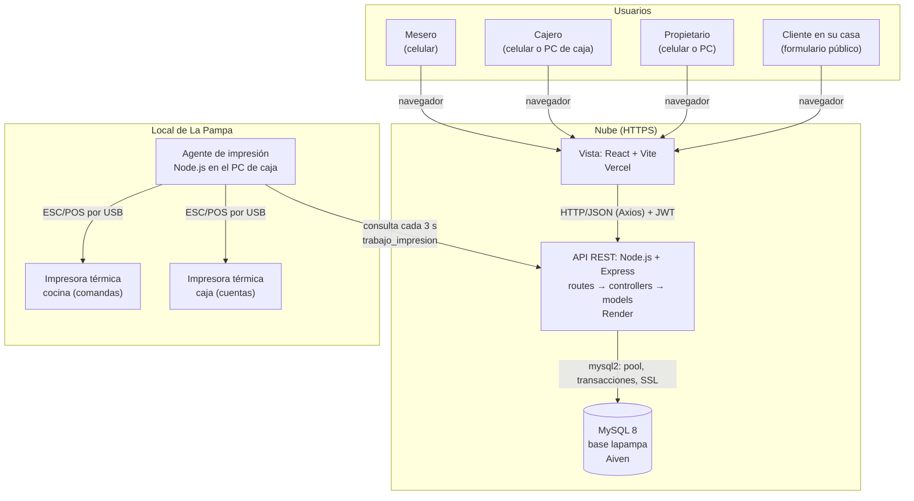

# Arquitectura del prototipo

Sistema web cliente-servidor de tres capas con patrón MVC: la **Vista** es el cliente React que corre en el navegador del celular; el **Controlador** y el **Modelo** viven en la API Express; los datos, en MySQL. Todo se publica en la nube con HTTPS para que el cliente pueda pedir domicilios desde su casa.

| Capa | Tecnología | Responsabilidad |
|---|---|---|
| Vista | React 18, Vite, React Router, Axios | Pantallas mobile-first por rol y formulario público de domicilio |
| Controlador | Express 5 (`api/src/controllers`, `routes`, `middlewares`) | Valida la petición (express-validator), verifica el token y el rol, responde JSON |
| Modelo | `api/src/models` con `mysql2/promise` | Consultas SQL y transacciones (cierre de pedido, pago, propina) |
| Datos | MySQL 8 | 13 tablas; ver [MER](bd/mer.md) y [diccionario](bd/diccionario.md) |
| Impresión | Agente Node.js (Sprint 3, HU16) | Toma los trabajos pendientes y los imprime en las 2 impresoras USB |

Despliegue paso a paso: [despliegue.md](despliegue.md).
