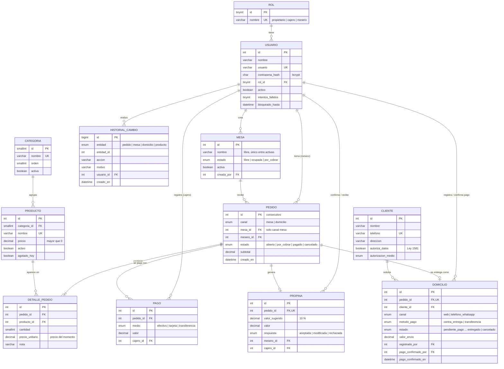

# Modelo Entidad-Relación — La Pampa Gastrobar

GitHub dibuja este diagrama automáticamente al abrir el archivo. Para exportarlo como imagen (para el documento de grado), pega el bloque en https://mermaid.live y descarga PNG o SVG.

